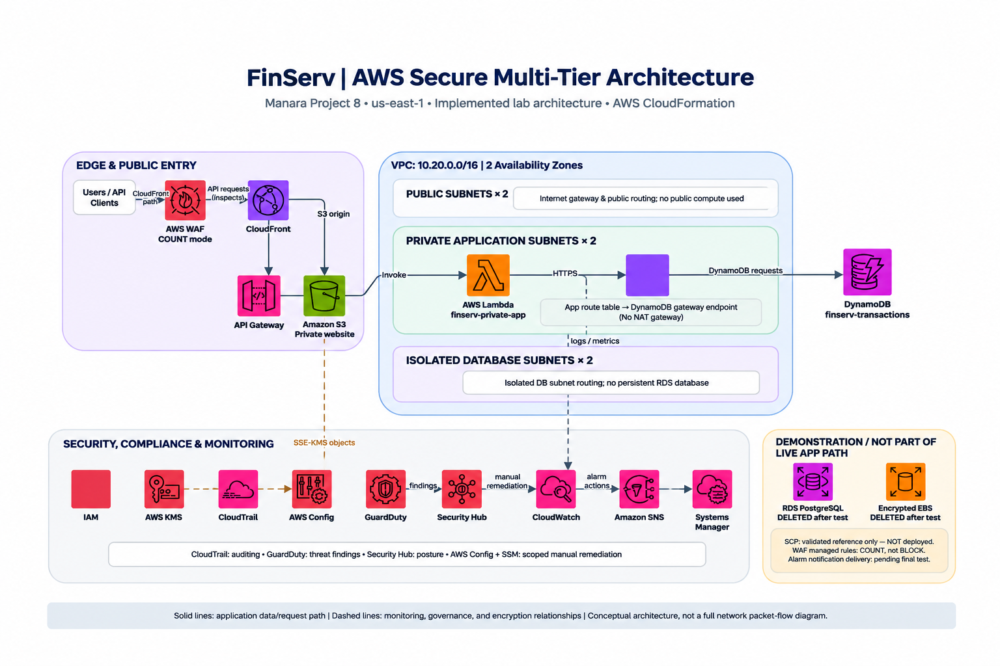
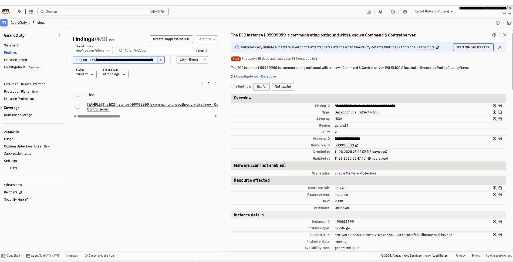
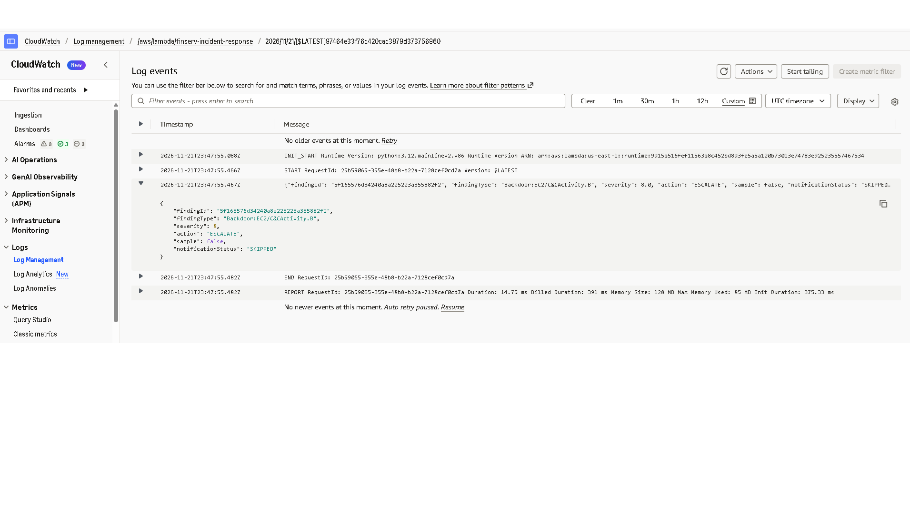
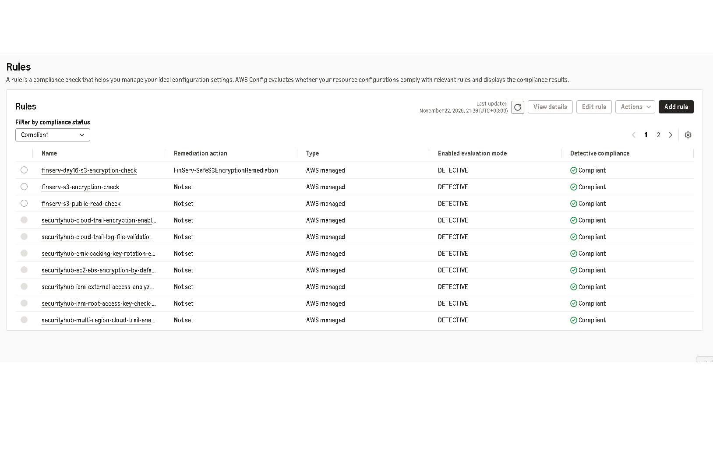
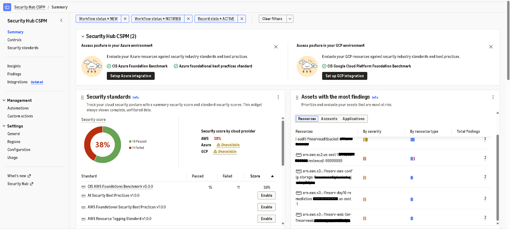

# FinServ — بنية سحابية آمنة متعددة الطبقات على AWS

**ملف أعمال في هندسة أمن الحوسبة السحابية | مشروع منارة الثامن (Manara Project 8)**

مشروع تطبيقي في أمن AWS يوضح كيفية الجمع بين **الدفاع متعدد الطبقات**، وعزل الشبكات، وتشفير البيانات، وإدارة الصلاحيات وفق مبدأ الحد الأدنى من الامتيازات، واكتشاف التهديدات، ومراقبة الامتثال، و**البنية التحتية بوصفها شيفرة** (Infrastructure as Code).

**اللغة:** [العربية](README.ar.md) | [English](README.md)

## فهرس المحتويات

1. [نظرة عامة على المشروع](#1-نظرة-عامة-على-المشروع)
2. [التصميم المعماري](#2-التصميم-المعماري)
   - [تصميم التطبيق ثلاثي الطبقات](#تصميم-التطبيق-ثلاثي-الطبقات)
   - [المخطط المعماري للمشروع](#المخطط-المعماري-للمشروع)
3. [الضوابط الأمنية](#3-الضوابط-الأمنية)
4. [التجارب العملية للضوابط الأمنية](#4-التجارب-العملية-للضوابط-الأمنية)
   - [التشفير](#التشفير)
   - [الشبكات الخاصة](#الشبكات-الخاصة)
   - [المراقبة الأمنية](#المراقبة-الأمنية)
   - [الامتثال والمعالجة التصحيحية](#الامتثال-والمعالجة-التصحيحية)
5. [البنية التحتية بوصفها شيفرة](#5-البنية-التحتية-بوصفها-شيفرة)
   - [دليل مجلدات CloudFormation](#دليل-مجلدات-cloudformation)
   - [وثائق المشروع](#وثائق-المشروع)
   - [أدلة التحقق الأمني](#أدلة-التحقق-الأمني)
6. [المراقبة والاستجابة للحوادث](#6-المراقبة-والاستجابة-للحوادث)
7. [حالة التنفيذ والقيود](#7-حالة-التنفيذ-والقيود)
8. [مدى تحقيق أهداف المشروع الثامن](#8-مدى-تحقيق-أهداف-المشروع-الثامن)
9. [هيكل المستودع](#9-هيكل-المستودع)
10. [الأدوات والتقنيات](#10-الأدوات-والتقنيات)
11. [الهدف من المشروع](#11-الهدف-من-المشروع)

**موارد إضافية:** [المخطط المعماري](#المخطط-المعماري-للمشروع) · [دليل النشر والتحقق](docs/deployment-guide.md) · [نتائج الاختبارات](tests/security-test-results.md) · [مصفوفة تحقيق المتطلبات](docs/requirements-compliance.md) · [خطة معالجة نتائج CIS](docs/cis-remediation-plan.md) · [الضوابط المتقدمة والاختبارات المتبقية](docs/advanced-security-controls.md)

---

> **ملاحظة معمارية بشأن الضوابط المتقدمة:** لم تُفعَّل بعض الضوابط ذات الأثر الواسع في حساب التعلّم المشترك، ومنها فرض سياسات التحكم في الخدمات على مستوى المؤسسة (SCP)، والمعالجة التصحيحية التلقائية عبر AWS Config، والتدوير المجدول للأسرار بواسطة Lambda. وقد وُثّقت حالة كل منها وحدود التنفيذ وطريقة اختبارها بأمان في [دليل الضوابط الأمنية المتقدمة](docs/advanced-security-controls.md). **ولا يُدّعى أن هذه الضوابط قد اختُبرت بصورة مكتملة.**

## 1. نظرة عامة على المشروع

يقدم **FinServ** نموذجًا عمليًا لتصميم بنية سحابية آمنة لتطبيق يحاكي بيئة الخدمات المالية باستخدام **Amazon Web Services (AWS)**.

يجمع المشروع بين تطبيق يعمل دون خوادم دائمة التشغيل (Serverless)، وشبكة افتراضية خاصة (VPC) مقسّمة إلى طبقات، وتخزين محمي للبيانات، وسجلات تدقيق مركزية، وآليات لاكتشاف التهديدات والاستجابة المنظمة للحوادث.

أُنشئ معظم مكونات البنية التحتية باستخدام **AWS CloudFormation**، وأُجريت اختبارات التحقق باستخدام **AWS CLI** و**PowerShell**.

| العنصر | الوصف |
|---|---|
| منطقة AWS | `us-east-1` |
| طبيعة البيئة | مختبر تعليمي وتجريبي للتحقق من ضوابط الأمن السحابي |
| أداة البنية التحتية بوصفها شيفرة | AWS CloudFormation |
| إدارة التكلفة | تصميم منخفض التكلفة، مع إزالة الموارد المؤقتة القابلة للفوترة بعد الاختبارات |

## 2. التصميم المعماري

يتكون التصميم من العناصر الآتية:

- **طبقة الوصول والتوزيع:** Amazon CloudFront وAWS WAF وموقع ويب مخزّن في Amazon S3.
- **طبقة التطبيق:** Amazon API Gateway وAWS Lambda.
- **الشبكات:** شبكة VPC تضم شبكات فرعية عامة، وشبكات خاصة للتطبيق، وشبكات معزولة لقواعد البيانات، موزعة على منطقتَي توافر (Availability Zones).
- **البيانات:** Amazon DynamoDB، مع نقطة نهاية من نوع Gateway VPC Endpoint.
- **التشفير:** AWS KMS وتشفير البيانات في S3، إلى جانب تجارب على تشفير موارد تخزين أخرى.
- **الحماية والكشف:** أدوار IAM محدودة الصلاحيات، وAmazon GuardDuty، وAWS Security Hub، وAWS Config.
- **التدقيق والمراقبة:** AWS CloudTrail وAmazon CloudWatch وAmazon SNS.
- **المعالجة والاستجابة:** AWS Systems Manager Automation ومكوّنات مضبوطة لمعالجة نتائج الكشف الأمني.

تنفّذ دالة Lambda عمليات معاملات تجريبية على DynamoDB. وقد استُخدمت نقطة فحص الصحة (`GET /health`) للتحقق من إتاحة مسار محدد من التطبيق.

### تصميم التطبيق ثلاثي الطبقات

يعتمد المشروع تصميمًا منطقيًا من **ثلاث طبقات** باستخدام خدمات مُدارة وبنية دون خوادم دائمة:

| الطبقة | خدمات AWS | الدور |
|---|---|---|
| **الويب (Web)** | CloudFront وAWS WAF وحاوية S3 خاصة للموقع | تقديم محتوى الموقع وفحص الطلبات الواردة |
| **التطبيق (Application)** | API Gateway وAWS Lambda | إتاحة نقطة فحص الصحة وتنفيذ منطق التطبيق |
| **البيانات (Data)** | DynamoDB وGateway VPC Endpoint | تخزين المعاملات التجريبية وإتاحة الوصول إلى الخدمة عبر نقطة نهاية خاصة بالشبكة |

**ما تحقق فعليًا:** أعادت نقطة `GET /health` في API Gateway استجابة HTTP `200`. كما نجح الاستدعاء المباشر لدالة Lambda في تنفيذ عمليتَي `PutItem` و`GetItem` على DynamoDB.

**قيود التنفيذ:** لم تُنشأ نقطة API مستقلة لتنفيذ المعاملات عبر API Gateway. ويستخدم التطبيق الحالي DynamoDB، لا قاعدة RDS دائمة. أما الشبكات الفرعية المعزولة لقواعد البيانات فقد أُنشئت ضمن التصميم، وأُجريت تجربة مؤقتة على قاعدة RDS مشفّرة، ثم حُذفت بعد اكتمال الاختبار.

### المخطط المعماري للمشروع



**الملفات الأصلية للمخطط:**
- [المخطط القابل للتعديل باستخدام draw.io](architecture/finserv-aws-security-architecture.drawio)
- [المخطط بصيغة Mermaid](architecture/architecture.md)

## 3. الضوابط الأمنية

يوضح الجدول الآتي الضوابط المطبّقة أو التي جرى اختبارها ضمن حدود المشروع. ولا يعني وجود خدمة في الجدول أن جميع إمكاناتها قد فُعّلت أو اختُبرت.

| المجال الأمني | ما نُفّذ أو جرى التحقق منه |
|---|---|
| عزل الشبكات | شبكات فرعية عامة، وخاصة بالتطبيق، ومعزولة لقواعد البيانات |
| تقييد الاتصال | مجموعات أمان (Security Groups) ومسارات توجيه مقيدة |
| الوصول الخاص إلى خدمات AWS | نقطة نهاية Gateway لخدمة DynamoDB |
| حماية البيانات | تشفير S3 باستخدام AWS KMS |
| الهوية والصلاحيات | أدوار IAM وسياسات محددة النطاق وفق مبدأ الحد الأدنى من الامتيازات |
| اكتشاف التهديدات | Amazon GuardDuty |
| تقييم الوضع الأمني | AWS Security Hub |
| تقييم الامتثال | قواعد AWS Config |
| التدقيق | AWS CloudTrail |
| المراقبة | سجلات CloudWatch ومقاييسه وإنذاراته |
| الإشعارات | Amazon SNS |
| المعالجة التصحيحية | AWS Systems Manager Automation؛ تم التحقق من التنفيذ اليدوي |
| إدارة الأسرار | جُرّب تخزين الأسرار في AWS Secrets Manager، لكن تدويرها بدالة Lambda مخصصة لم يُتحقق منه |
| التشفير بمفتاح يديره العميل | مفتاح KMS يديره العميل لتشفير بيانات S3، مستقل عن مفتاح AWS المُدار المستخدم افتراضيًا لتشفير EBS |
| منع الوصول العام إلى S3 | التحقق من إعدادات Block Public Access على مستوى الحاويات الثماني والحساب |
| التشفير الافتراضي لـ EBS | مفعّل في `us-east-1` باستخدام `alias/aws/ebs` |
| CloudFront وWAF | مصدر ويب خاص في S3 عبر CloudFront؛ عملت مجموعات قواعد WAF المُدارة في وضع **Count** |
| معالجة نتائج الكشف | أدت نتيجة GuardDuty اصطناعية إلى تشغيل EventBridge وLambda؛ وتأكد قرار `ESCALATE` دون التحقق من إشعار SNS التلقائي |
| تقييم CIS الأمني | تفعيل معيار CIS AWS Foundations Benchmark v5.0؛ تفعيل 40 عنصر تحكم؛ نتيجة 38% (نجح 15 وفشل 11 في التقييم الموثق)، **دون ادعاء امتثال كامل** |
| تسجيل حركة مرور الشبكة | أرسلت VPC Flow Logs الخاصة بالمشروع سجلات `NODATA` إلى CloudWatch؛ مدة الاحتفاظ سبعة أيام |
| سلامة سجلات CloudTrail | التحقق من تدقيق أحداث الإدارة في مناطق متعددة، وتشفير السجلات باستخدام KMS، والتحقق من سلامة ملفات السجل |

## 4. التجارب العملية للضوابط الأمنية

### التشفير

تم التحقق من تخزين كائنات S3 مشفّرة باستخدام **AWS KMS**.

كما أُجريت تجارب على تشفير وحدة تخزين EBS وقاعدة بيانات Amazon RDS خاصة. وكانت هذه الموارد مؤقتة، وقد حُذفت بعد انتهاء الاختبارات.

### الشبكات الخاصة

أُنشئت طبقات شبكية منفصلة، مع ضوابط اتصال محددة عبر مجموعات الأمان.

وتصل طبقة التطبيق الخاصة إلى DynamoDB عبر **Gateway VPC Endpoint**، دون الحاجة إلى بوابة NAT Gateway من أجل هذا المسار.

### المراقبة الأمنية

أُعدّت إنذارات في CloudWatch لرصد أخطاء Lambda الخاصة بالتطبيق، وحالات تقييد استدعائها (Throttling)، وأخطاء دالة الاستجابة للحوادث، مع إعداد موضوع SNS بوصفه وجهة للإشعارات.

### الامتثال والمعالجة التصحيحية

أُنشئت قاعدة في AWS Config ودليل تشغيل آلي (SSM Automation Runbook) لتنفيذ معالجة تصحيحية مضبوطة تتعلق بتشفير S3.

**تم اختبار المعالجة اليدوية بنجاح، بينما بقيت المعالجة التلقائية معطلة.**

## 5. البنية التحتية بوصفها شيفرة

نُظِّمت قوالب CloudFormation داخل المجلد `cloudformation/`، مع الإبقاء على تقسيمها بحسب أيام التطوير.

تتضمن القوالب مكونات الشبكات والتشفير، والبنية التطبيقية، وخدمات الحماية، والمراقبة، والتجارب الأمنية المؤقتة.

تستخدم بعض القوالب معاملات (Parameters) قابلة للتخصيص لتجنب تثبيت معرّفات البيئة داخل الشيفرة.

**تنبيه مهم:** هذه القوالب أمثلة تطبيقية تعليمية، وترتبط ببعضها تبعيات ومتطلبات سابقة. **ولا يُنصح بنشرها جميعًا دفعة واحدة** قبل مراجعة المعاملات المطلوبة، وترتيب النشر، وأسماء الموارد، والموارد الموجودة مسبقًا.

**وثائق IAM:** يحتوي `iam/flowlogs/` على أمثلة لسياسات الثقة والصلاحيات اللازمة لإرسال سجلات VPC Flow Logs إلى CloudWatch Logs. ومعرّف حساب AWS الوارد في هذه الأمثلة قيمة توضيحية يجب استبدالها قبل استخدامها.

### دليل مجلدات CloudFormation

| المجلد | الغرض الرئيسي |
|---|---|
| الجذر / `Recovered-Templates` | تأسيس الشبكة ومجموعات الأمان وتشفير KMS/S3 |
| `Day 04–05` | ضوابط الوصول عبر IAM وSecrets Manager |
| `Day 06–07` | التدقيق باستخدام CloudTrail وإعداد AWS Config |
| `Day 08–09` | GuardDuty وSecurity Hub |
| `Day 10–11` | الاستجابة للحوادث باستخدام EventBridge/Lambda وتنبيهات SNS |
| `Day 12–15` | طبقات الويب والتطبيق والبيانات والوصول إلى DynamoDB وواجهة API |
| `Day 16` | المعالجة التصحيحية عبر AWS Config وSSM Automation |
| `Day 17` | ضوابط AWS WAF المرتبطة بـ CloudFront |
| `Day 18` | تجارب EBS/RDS المؤقتة ومرجع سياسة SCP |
| `Day 19` | المراقبة والإنذارات باستخدام CloudWatch |

اجتازت **قوالب YAML الثمانية والعشرون** اختبار `aws cloudformation validate-template` بتاريخ **22 نوفمبر 2026**. ويؤكد ذلك صحة بنية القوالب ضمن نطاق الفحص، **ولا يثبت** إمكانية نشر المشروع كاملًا من البداية في حساب جديد دون إعدادات إضافية.

### وثائق المشروع

- [المخطط المعماري للحل](architecture/finserv-aws-security-architecture.png)
- [دليل نشر CloudFormation والتحقق من التنفيذ](docs/deployment-guide.md)
- [مصفوفة تحقيق متطلبات مشروع منارة الثامن](docs/requirements-compliance.md)
- [نتائج الاختبارات والتحقق الأمني](tests/security-test-results.md)
- [نتائج معيار CIS v5.0 وخطة المعالجة التصحيحية](docs/cis-remediation-plan.md)
- [اختبار محاكاة حدود الصلاحيات في IAM](docs/iam-permissions-boundary-test.md)
- [الضوابط الأمنية المتقدمة وخطة استكمال اختبارات التحقق](docs/advanced-security-controls.md)

### أدلة التحقق الأمني

التُقطت صور الأدلة من وحدة تحكم AWS بتاريخ **22 نوفمبر 2026**. نتائج GuardDuty المعروضة اصطناعية لأغراض الاختبار، وتعكس نتائج الامتثال حالة الحساب التي لوحظت عند الفحص.

| اكتشاف التهديدات | الاستجابة للحوادث |
|---|---|
|  |  |
| **GuardDuty:** نتيجة اصطناعية عالية الخطورة من نوع Backdoor C&C | **Lambda:** تسجيل قرار `ESCALATE`؛ لم يُرسل إشعار SNS تلقائيًا في الاختبار |

| الامتثال في AWS Config | تقييم CIS في Security Hub |
|---|---|
|  |  |
| **AWS Config:** ثلاث قواعد متوافقة ضمن المشروع؛ وتجهيز معالجة يدوية عبر SSM | **Security Hub:** معيار CIS v5.0، ونتيجة 38%، و15 عنصرًا ناجحًا و11 عنصرًا فاشلًا في التقييم الموثّق |

**تنبيه بشأن نتائج GuardDuty:** قد يؤدي توليد نتائج الاختبار الاصطناعية إلى ظهور عدد كبير من النتائج. ولا يجوز تفسير الرقم **479** الظاهر في لقطة الشاشة على أنه 479 هجومًا حقيقيًا أو حادثًا أمنيًا مؤكدًا.

**دليل إضافي لمحاكاة صلاحيات IAM:** [نتائج محاكي سياسات IAM بصيغة JSON](docs/evidence/iam-permissions-boundary-test.json). أظهر الاختبار السماح بـ `s3:ListBucket` والمنع الصريح لـ `s3:DeleteBucket` باستخدام سياسة حدّ للصلاحيات؛ **ولم تُطبّق السياسة على دور IAM فعلي**.

## 6. المراقبة والاستجابة للحوادث

يتضمن إعداد المراقبة ثلاثة إنذارات في CloudWatch:

- أخطاء دالة Lambda الخاصة بالتطبيق.
- حالات تقييد استدعاء دالة Lambda الخاصة بالتطبيق (`Throttles`).
- أخطاء دالة Lambda المخصصة للاستجابة للحوادث.

ضُبط الاحتفاظ بالسجلات في CloudWatch Logs لمدة **سبعة أيام** لدوال Lambda الخاضعة للمراقبة.

في **21 نوفمبر 2026**، تم التحقق من وصول رسالة بريد إلكتروني أُرسلت **مباشرةً عبر SNS**. لكن ذلك لا يثبت نجاح الإشعارات التلقائية عند انتقال إنذارات CloudWatch بين الحالات، ولا الإشعارات الصادرة من دالة الاستجابة للحوادث.

وفي **22 نوفمبر 2026**، نجحت نتيجة GuardDuty اصطناعية عالية الخطورة في تشغيل قاعدة EventBridge واستدعاء دالة Lambda، مع **استدعاء واحد ودون أخطاء**، وتسجيل قرار `ESCALATE`. وظل إرسال إشعارات SNS التلقائي غير مختبَر.

## 7. حالة التنفيذ والقيود

يوثّق هذا المستودع مختبرًا أمنيًا سحابيًا جرى تنفيذه واختبار جوانب محددة منه؛ **ولا يمثل منصة خدمات مالية إنتاجية جاهزة للاستخدام الفعلي**.

**دلالات الحالة:** «مُتحقَّق منه» تعني وجود دليل على الاختبار ضمن النطاق المذكور؛ و«جزئي» تعني أن بعض الجوانب نُفّذت دون استكمال جميع متطلبات التحقق؛ و«محاكاة مُتحقَّق منها» لا تعني تطبيق الضابط على مورد فعلي.

### ملخص حالة التنفيذ

| هدف المشروع | الحالة | الدليل أو حدود التحقق |
|---|---|---|
| شبكة VPC متعددة الطبقات ومجموعات الأمان | **مُتحقَّق منه** | تصميم شبكات عامة وخاصة بالتطبيق ومعزولة لقواعد البيانات |
| تشفير S3 باستخدام KMS | **مُتحقَّق منه** | استخدام مفتاح يديره العميل واختبار SSE-KMS |
| Secrets Manager | **جزئي** | تجربة تخزين الأسرار؛ عدم التحقق من تدويرها باستخدام Lambda مخصصة |
| اكتشاف التهديدات عبر GuardDuty | **مُتحقَّق منه** | نتائج اصطناعية من نوع Tor وBackdoor C&C |
| استجابة EventBridge وLambda | **مُتحقَّق منه** | نتيجة اصطناعية بدرجة خطورة 8، واستدعاء واحد، وصفر أخطاء، وقرار `ESCALATE` |
| تقييم Security Hub وفق CIS v5.0 | **جزئي** | 40 عنصرًا مفعّلًا؛ نتيجة 38% (15 نجح، 11 فشل) بتاريخ 22 نوفمبر 2026؛ لا يُدّعى امتثال كامل |
| تدقيق CloudTrail وسلامة السجلات | **مُتحقَّق منه** | أحداث إدارة عبر مناطق متعددة والتحقق من سلامة ملفات السجل |
| المعالجة التصحيحية في AWS Config | **جزئي** | نجاح تشغيل SSM يدويًا؛ المعالجة التلقائية معطّلة |
| VPC Flow Logs | **مُتحقَّق منه ضمن نطاق الاختبار** | الحالة `ACTIVE` والتسليم `SUCCESS` ووصول سجلات `NODATA` إلى CloudWatch، دون إثبات التقاط حركة `ACCEPT/REJECT` |
| الحماية باستخدام AWS WAF | **جزئي** | قواعد مُدارة في وضع `Count`؛ لم يثبت الحظر الفعلي |
| حدود صلاحيات IAM (Permissions Boundary) | **مُتحقَّق منه بالمحاكاة فقط** | أظهر محاكي IAM السماح بـ `s3:ListBucket` والمنع الصريح لـ `s3:DeleteBucket`؛ [دليل المحاكاة](docs/iam-permissions-boundary-test.md). لم تُطبّق السياسة على دور فعلي |
| سياسات AWS Organizations من نوع SCP | **غير منشورة** | قالب مرجعي فقط، دون إثبات فرض السياسة على مؤسسة AWS |
| تدوير أسرار RDS عبر Lambda | **لم يُتحقَّق منه** | تجربة بيانات اعتماد RDS المُدارة عبر AWS، دون اختبار دورة تدوير باستخدام Lambda مخصصة |
| طبقات EC2/RDS الإنتاجية | **غير منشورة** | التطبيق يعمل دون خوادم دائمة، وقد أُزيل مورد RDS المؤقت بعد الاختبار |

**أهم القيود:**

- كانت موارد PostgreSQL RDS وEBS المستخدمة في تجارب اليوم الثامن عشر مؤقتة، وحُذفت بعد الاختبار.
- تم التحقق من قالب مرجعي لسياسة SCP، دون نشرها على AWS Organizations.
- ضُبطت مجموعات قواعد AWS WAF المُدارة على وضع `Count`. ولم ينجح نشر قاعدة حظر مخصصة ضمن التجربة.
- تعتمد بعض قوالب CloudFormation على موارد أو مخرجات قوالب سابقة، وقد ينتج عن نشرها دون مراجعة تعارض في الأسماء أو القواعد أو الموارد.
- توثَّق اختبارات الأمان والمراقبة ومسارات التكامل بصورة مستقلة، ولا ينبغي افتراض أن جميع المسارات قد اختُبرت من بدايتها إلى نهايتها.
- لم يخضع المختبر لتدقيق أمني رسمي أو اختبار اختراق شامل أو تقييم لجاهزيته للإنتاج؛ **ولا تُدَّعى له أي شهادة امتثال رسمية**.

## 8. مدى تحقيق أهداف المشروع الثامن

قُيِّم التنفيذ في ضوء متطلبات **Manara Project 8**، مع الفصل بين ما تحقق بصورة عملية، وما نُفّذ جزئيًا، وما بقي مرجعًا نظريًا أو تجربة غير مكتملة.

[الاطلاع على مصفوفة تحقيق متطلبات مشروع منارة الثامن](docs/requirements-compliance.md)

توضح المصفوفة الأدلة المتاحة لكل متطلب، وحدود الاختبارات، والقدرات التي تحتاج إلى تنفيذ أو تحقق إضافي.

## 9. هيكل المستودع

يضم المستودع قوالب البنية التحتية بوصفها شيفرة، والمخططات المعمارية، وأمثلة سياسات IAM، ووثائق الأمان، وأدلة الاختبارات. وقد أُبقيت أسماء الملفات والمجلدات كما هي لتعمل الروابط في النسختين العربية والإنجليزية.

```text
finserv-aws-security-architecture/
├── architecture/
│   ├── architecture.md
│   ├── finserv-aws-security-architecture.drawio
│   └── finserv-aws-security-architecture.png
├── cloudformation/
│   ├── Day 04/
│   ├── Day 05/
│   ├── ... (additional day folders)
│   ├── Day 19/
│   └── Recovered-Templates/
├── docs/
│   ├── evidence/
│   │   ├── aws-config-compliance-rules.png
│   │   ├── guardduty-findings-details.png
│   │   ├── iam-permissions-boundary-test.json
│   │   ├── incident-response-logs.png
│   │   └── securityhub-cis.png
│   ├── advanced-security-controls.md
│   ├── cis-remediation-plan.md
│   ├── deployment-guide.md
│   ├── iam-permissions-boundary-test.md
│   └── requirements-compliance.md
├── iam/
│   ├── flowlogs/
│   │   ├── finserv-flowlogs-permissions.json
│   │   └── finserv-flowlogs-trust.json
│   └── README.md
├── tests/
│   └── security-test-results.md
├── .gitignore
├── README.ar.md
└── README.md
```

## 10. الأدوات والتقنيات

استُخدمت في بناء المشروع واختباره أو توثيق ضوابطه الخدمات والأدوات الآتية:

AWS CloudFormation، وAWS CLI، وPowerShell، وAWS IAM، وAmazon VPC، وEC2 Security Groups، وAmazon S3، وAWS KMS، وAWS Lambda، وAmazon API Gateway، وAmazon DynamoDB، وAmazon CloudFront، وAWS WAF، وAWS CloudTrail، وAWS Config، وAmazon GuardDuty، وAWS Security Hub، وAmazon CloudWatch، وAmazon SNS، وAWS Systems Manager، وAmazon RDS، وAmazon EBS.

وتجدر الإشارة إلى أن ذكر خدمة هنا لا يعني استمرار تشغيل جميع الموارد التي استُخدمت في التجارب أو اكتمال اختبار كل وظائفها.

## 11. الهدف من المشروع

يهدف مشروع FinServ إلى إظهار مهارات عملية في **هندسة الحلول السحابية على AWS وهندسة أمن الحوسبة السحابية**، وتشمل:

- تصميم بنية تحتية سحابية آمنة.
- إدارة الهوية والتحكم في الوصول.
- تقسيم الشبكات وعزل مستويات الاتصال.
- حماية البيانات بالتشفير.
- اكتشاف التهديدات وتحليل نتائجها.
- المراقبة والاستجابة للحوادث.
- تقييم الامتثال وإجراء المعالجات التصحيحية.
- بناء الموارد وإدارتها بوصفها شيفرة.
- اختبار الضوابط الأمنية وتوثيق نتائجها وحدودها بوضوح.

**البرنامج:** مسار مهندس حلول AWS في منارة — المشروع الثامن.

**مجال ملف الأعمال:** هندسة أمن الحوسبة السحابية (AWS Cloud Security Engineering).

---

*أُعدّت هذه النسخة العربية استنادًا إلى توثيق المشروع المنشور بالإنجليزية؛ وتظل ملفات الإعداد والاختبارات والأدلة الأصلية مرجعًا للتحقق من تفاصيل التنفيذ. الروابط إلى الوثائق التقنية الداخلية تقود إلى ملفاتها الإنجليزية الحالية.*
