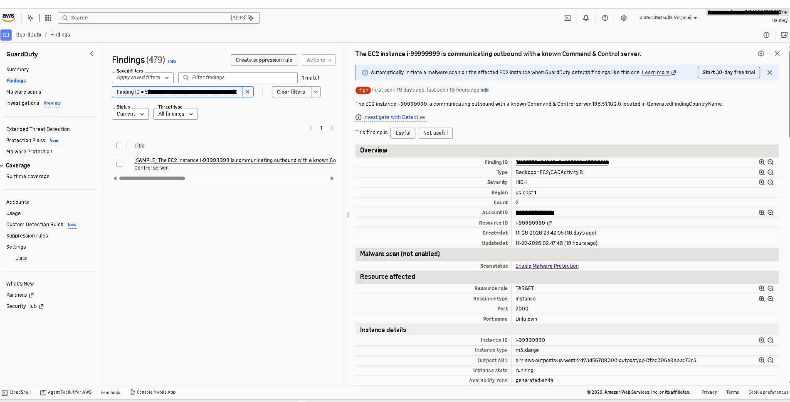
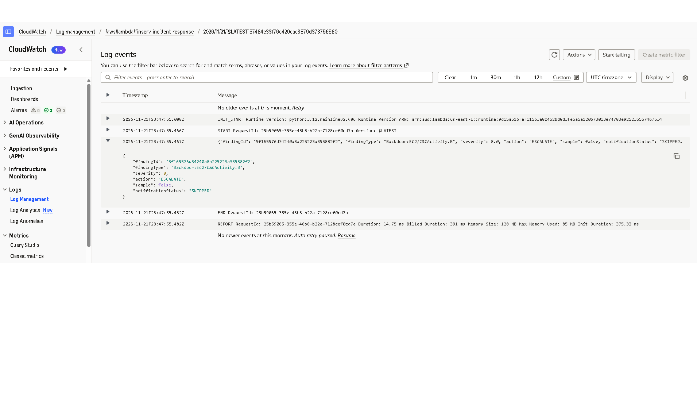
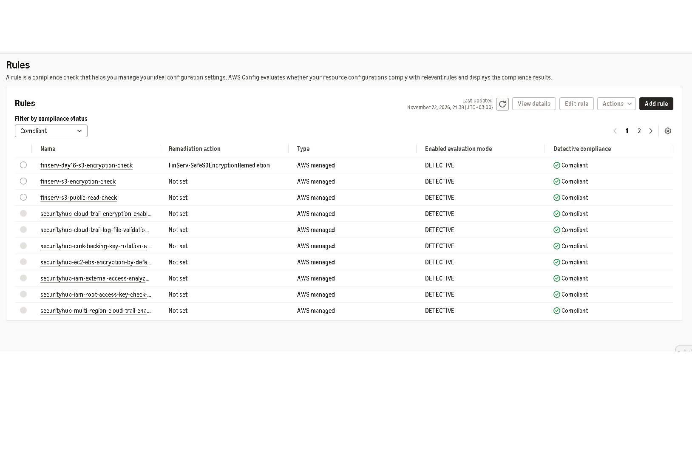
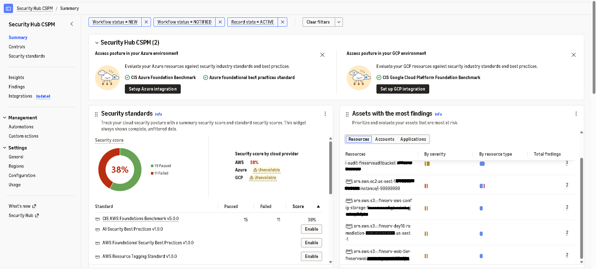

# FinServ — Secure AWS Multi-Tier Architecture

**AWS Cloud Security Engineering Portfolio | Manara Project 8**

A hands-on AWS security project demonstrating defense-in-depth, private networking, encryption, least-privilege IAM, threat detection, compliance monitoring, and Infrastructure as Code.


## Table of Contents

1. [Project Overview](#1-project-overview)
2. [Architecture](#2-architecture)
3. [Security Controls](#3-security-controls)
4. [AWS Services and Implementation](#4-aws-services-and-implementation)
5. [Infrastructure as Code](#5-infrastructure-as-code)
6. [Monitoring and Incident Response](#6-monitoring-and-incident-response)
7. [Security Testing and Evidence](#7-security-testing-and-evidence)
8. [Limitations and Lessons Learned](#8-limitations-and-lessons-learned)

## 1. Project Overview

This project demonstrates how to design and secure a financial-services-style application on AWS.

It combines a serverless application with a segmented VPC, protected data storage, centralized logging, automated security detection, and controlled incident-response workflows.

The infrastructure was created primarily with **AWS CloudFormation** and tested using AWS CLI and PowerShell.

**Region:** us-east-1

**Environment:** Learning and security demonstration lab

**Infrastructure as Code:** AWS CloudFormation

**Cost approach:** Low-cost lab with temporary billable resources removed after testing

## 2. Architecture

The architecture includes:

- **Edge:** Amazon CloudFront, AWS WAF, and an S3-hosted website

- **Application:** Amazon API Gateway and AWS Lambda

- **Networking:** VPC with public, private application, and isolated database subnets across two Availability Zones

- **Data:** Amazon DynamoDB with a gateway VPC endpoint

- **Encryption:** AWS KMS, S3 server-side encryption, and encrypted storage demonstrations

- **Security:** IAM least privilege, Amazon GuardDuty, AWS Security Hub, and AWS Config

- **Audit and monitoring:** AWS CloudTrail, Amazon CloudWatch, and Amazon SNS

- **Remediation:** AWS Systems Manager Automation and controlled incident-response components

The application Lambda function performs synthetic DynamoDB transactions. Its health-check endpoint supports application availability verification.

## 3. Security Controls

| Security area | Implementation |
|---|---|
| Network isolation | Public, private application, and isolated database subnets |
| Network access | Security groups and restricted routing |
| Private AWS service access | DynamoDB gateway endpoint |
| Data protection | AWS KMS and S3 encryption |
| Identity and access | Least-privilege IAM roles and scoped policies |
| Threat detection | Amazon GuardDuty |
| Security posture | AWS Security Hub |
| Compliance | AWS Config rules |
| Auditing | AWS CloudTrail |
| Monitoring | CloudWatch Logs, metrics, and alarms |
| Notifications | Amazon SNS |
| Remediation | Systems Manager Automation with manual execution |
| Secrets management | AWS Secrets Manager; secret storage demonstrated, custom Lambda rotation not verified |
| Customer-managed encryption | AWS KMS customer-managed key for encrypted S3 data; separate from the AWS-managed EBS default key |
| S3 public access protection | All eight buckets and account-level Block Public Access settings verified |
| EBS default encryption | Enabled in us-east-1 using alias/aws/ebs |
| CloudFront and WAF | Private S3 web origin through CloudFront; managed WAF rules operated in Count mode |
| Incident processing | Synthetic GuardDuty finding triggered EventBridge and Lambda; ESCALATE verified, SNS automation untested |
| CIS security assessment | CIS AWS Foundations Benchmark v5.0 enabled; 40 controls enabled; 38% security score (15 passed, 11 failed); full compliance not claimed |
| Network traffic logging | FinServ VPC Flow Logs delivered NODATA records to CloudWatch; seven-day retention |
| CloudTrail integrity | Multi-Region management-event auditing, KMS encryption and log-file validation verified |

## 4. Security Demonstrations

### Encryption

Verified encrypted S3 objects using AWS KMS.

Demonstrated encrypted EBS and private encrypted Amazon RDS storage. The temporary EBS and RDS resources were deleted after testing.

### Private Networking

Implemented segmented network tiers and restricted security-group communication.

The private application architecture uses DynamoDB access through a gateway VPC endpoint without requiring a NAT Gateway.

### Security Monitoring

Configured CloudWatch alarms for application errors, throttling, and incident-response errors, with an SNS topic as the notification destination.

### Compliance and Remediation

Created an AWS Config rule and an SSM Automation runbook for a scoped S3 encryption remediation demonstration.

Automatic remediation was disabled. Manual remediation was tested successfully.

## 5. Infrastructure as Code

CloudFormation templates are organized under `cloudformation/`, preserving their development-day folders.

The repository includes networking, encryption, application infrastructure, security services, monitoring, and temporary security demonstrations.

Several templates use configurable CloudFormation parameters to avoid hardcoded environment identifiers.

These templates are educational Infrastructure as Code examples. They have dependencies and are **not intended to be deployed all at once without reviewing the required parameters, deployment order, resource names, and existing resources**.

**IAM documentation:** The `iam/flowlogs/` directory contains example IAM trust and permissions policies for publishing VPC Flow Logs to CloudWatch Logs. The account ID in these examples is a placeholder.

### CloudFormation Directory Index

| Directory | Main purpose |
|---|---|
| Root / Recovered-Templates | Network foundation, security groups and KMS/S3 encryption |
| Day 04-05 | IAM access controls and Secrets Manager |
| Day 06-07 | CloudTrail auditing and AWS Config |
| Day 08-09 | GuardDuty and Security Hub |
| Day 10-11 | EventBridge/Lambda incident response and SNS alerts |
| Day 12-15 | Web, application, data, DynamoDB access and API tiers |
| Day 16 | AWS Config remediation and SSM Automation |
| Day 17 | CloudFront WAF security controls |
| Day 18 | Temporary EBS/RDS demonstrations and SCP reference |
| Day 19 | CloudWatch monitoring and alarms |

All 28 YAML templates passed AWS CloudFormation validate-template on November 22, 2026. This validates template structure, not a full fresh-account deployment.

### Project Documentation

- [Solution Architecture Diagram](architecture/finserv-aws-security-architecture.png)
- [CloudFormation Deployment and Verification Guide](docs/deployment-guide.md)
- [Project 8 Requirements Compliance Matrix](docs/requirements-compliance.md)
- [Security Testing Results](tests/security-test-results.md)
- [CIS v5.0 Security Findings and Remediation Plan](docs/cis-remediation-plan.md)


### Security Verification Evidence

Screenshots captured from the AWS console on November 22, 2026. GuardDuty findings are synthetic; the compliance results represent the observed account state.

| Threat Detection | Incident Response |
|---|---|
|  |  |
| **GuardDuty:** Synthetic Backdoor C&C finding, HIGH severity | **Lambda:** ESCALATE recorded; automatic SNS notification skipped |

| AWS Config Compliance | Security Hub CIS Assessment |
|---|---|
|  |  |
| **AWS Config:** Three FinServ rules compliant; manual SSM remediation configured | **Security Hub:** CIS v5.0, 38% score, 15 passed and 11 failed controls |


**GuardDuty testing note:** GuardDuty sample generation can create many synthetic findings. The 479 findings displayed in the evidence screenshot should not be interpreted as 479 real attacks or security incidents.

## 6. Monitoring and Incident Response

The monitoring implementation includes three CloudWatch alarms:

- Application Lambda errors

- Application Lambda throttles

- Incident-response Lambda errors

CloudWatch Logs retention was configured for seven days for the monitored Lambda functions.

Direct SNS email delivery was verified on November 21, 2026. Automatic CloudWatch alarm notifications and SNS delivery from the incident-response Lambda remain untested. On November 22, a synthetic high-severity GuardDuty finding successfully triggered EventBridge and Lambda (1 invocation, 0 errors; ESCALATE recorded).

## 7. Implementation Status and Limitations

This repository documents an implemented AWS security lab rather than a production-ready financial-services platform.

### Implementation Status Summary

| Project objective | Status | Evidence / limitation |
|---|---|---|
| Multi-tier VPC and security groups | VERIFIED | Public, private app and isolated DB subnet design |
| S3 and KMS encryption | VERIFIED | Customer-managed KMS key and SSE-KMS testing |
| Secrets Manager | PARTIAL | Secret storage demonstrated; custom Lambda rotation not verified |
| GuardDuty threat detection | VERIFIED | Synthetic Tor and Backdoor C&C findings |
| EventBridge and Lambda response | VERIFIED | Severity-8 synthetic finding, one invocation, zero errors, ESCALATE |
| Security Hub CIS v5.0 | PARTIAL | 40 controls enabled; 38% security score (15 passed, 11 failed) on November 22, 2026 |
| CloudTrail audit integrity | VERIFIED | Multi-Region management events and log-file validation |
| AWS Config remediation | PARTIAL | Manual SSM remediation verified; automatic remediation disabled |
| VPC Flow Logs | VERIFIED | ACTIVE, SUCCESS, CloudWatch NODATA ingestion |
| WAF protection | PARTIAL | Managed rules in Count mode; blocking not demonstrated |
| IAM permission boundary | NOT DEMONSTRATED | No enforced boundary test established |
| AWS Organizations SCP | NOT DEPLOYED | Reference template only |
| RDS Lambda rotation | NOT DEMONSTRATED | AWS-managed RDS credentials demonstrated; custom Lambda rotation not verified |
| EC2/RDS production tiers | NOT DEPLOYED | Serverless lab; temporary RDS test resource removed |

Important limitations:

- The PostgreSQL RDS and EBS resources from Day 18 were temporary demonstrations and were deleted after verification.

- An AWS Organizations SCP example was validated as a reference template but was not deployed.

- AWS WAF managed rule groups were configured in Count mode. A proposed custom blocking rule was not successfully deployed.

- Some templates describe alternative configurations or require resources from earlier stacks. They must be reviewed to avoid duplicate-rule or resource-conflict errors.

- Security validation, monitoring, and end-to-end testing are documented separately.

- No claim is made that this lab has undergone a formal security audit, penetration test, or production readiness assessment.


## 8. Compliance with Project 8 Objectives
The implementation has been assessed against the Manara Project 8 objectives.

[View the Project 8 Requirements Compliance Matrix](docs/requirements-compliance.md)

The matrix identifies verified implementations, partial demonstrations, and security capabilities that require additional testing.


## 9. Repository Structure

```text

finserv-aws-security-architecture/
├── cloudformation/
│   ├── Day 04/
│   ├── Day 05/
│   ├── ...
│   ├── Day 19/
│   └── Recovered-Templates/
├── architecture/
├── docs/
├── iam/
├── tests/
├── .gitignore
└── README.md

```

## 10. Tools and Technologies

AWS CloudFormation, AWS CLI, PowerShell, IAM, VPC, EC2 Security Groups, S3, KMS, Lambda, API Gateway, DynamoDB, CloudFront, AWS WAF, CloudTrail, AWS Config, GuardDuty, Security Hub, CloudWatch, SNS, Systems Manager, RDS, and EBS.

## 11. Project Objective

The goal of this project is to demonstrate practical AWS solutions architecture and cloud security engineering skills, including:

- Secure infrastructure design

- Identity and access management

- Network segmentation

- Data encryption

- Threat detection

- Monitoring and incident response

- Compliance and remediation

- Infrastructure as Code

- Security verification and documentation

**Project:** Manara AWS Solutions Architect learning path — Project 8

**Portfolio focus:** AWS Cloud Security Engineering


### AWS Architecture Diagram


**Architecture files:**
- [Editable AWS diagram (draw.io)](architecture/finserv-aws-security-architecture.drawio)
- [Mermaid architecture diagram](architecture/architecture.md)

