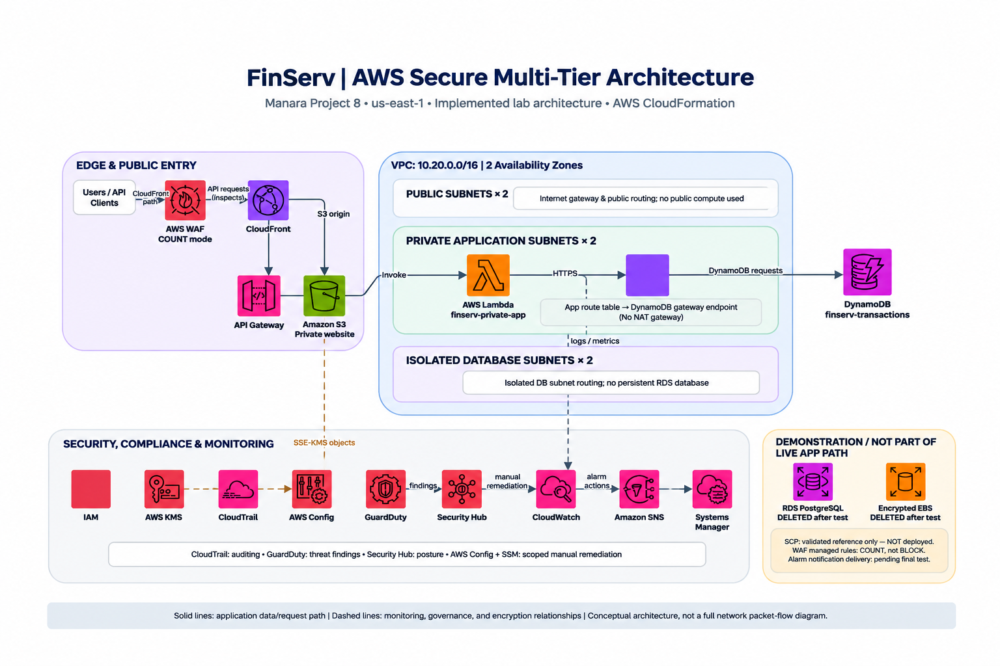

# FinServ — Secure AWS Multi-Tier Architecture

**AWS Cloud Security Engineering Portfolio | Manara Project 8**

A hands-on AWS security project demonstrating defense-in-depth, private networking, encryption, least-privilege IAM, threat detection, compliance monitoring, and Infrastructure as Code.

## 1. Project Overview

This project demonstrates how to design and secure a financial-services-style application on AWS.

It combines a serverless application with a segmented VPC, protected data storage, centralized logging, automated security detection, and controlled incident-response workflows.

The infrastructure was created primarily with **AWS CloudFormation** and tested using AWS CLI and PowerShell.

**Region:** us-east-1

**Environment:** Learning and security demonstration lab

**Infrastructure as Code:** AWS CloudFormation

**Cost approach:** Low-cost lab with temporary billable resources removed after testing

## 2. Architecture

The architecture includes:

- **Edge:** Amazon CloudFront, AWS WAF, and an S3-hosted website

- **Application:** Amazon API Gateway and AWS Lambda

- **Networking:** VPC with public, private application, and isolated database subnets across two Availability Zones

- **Data:** Amazon DynamoDB with a gateway VPC endpoint

- **Encryption:** AWS KMS, S3 server-side encryption, and encrypted storage demonstrations

- **Security:** IAM least privilege, Amazon GuardDuty, AWS Security Hub, and AWS Config

- **Audit and monitoring:** AWS CloudTrail, Amazon CloudWatch, and Amazon SNS

- **Remediation:** AWS Systems Manager Automation and controlled incident-response components

The application Lambda function performs synthetic DynamoDB transactions. Its health-check endpoint supports application availability verification.

## 3. Security Controls

| Security area | Implementation |
|---|---|
| Network isolation | Public, private application, and isolated database subnets |
| Network access | Security groups and restricted routing |
| Private AWS service access | DynamoDB gateway endpoint |
| Data protection | AWS KMS and S3 encryption |
| Identity and access | Least-privilege IAM roles and scoped policies |
| Threat detection | Amazon GuardDuty |
| Security posture | AWS Security Hub |
| Compliance | AWS Config rules |
| Auditing | AWS CloudTrail |
| Monitoring | CloudWatch Logs, metrics, and alarms |
| Notifications | Amazon SNS |
| Remediation | Systems Manager Automation with manual execution |

## 4. Security Demonstrations

### Encryption

Verified encrypted S3 objects using AWS KMS.

Demonstrated encrypted EBS and private encrypted Amazon RDS storage. The temporary EBS and RDS resources were deleted after testing.

### Private Networking

Implemented segmented network tiers and restricted security-group communication.

The private application architecture uses DynamoDB access through a gateway VPC endpoint without requiring a NAT Gateway.

### Security Monitoring

Configured CloudWatch alarms for application errors, throttling, and incident-response errors, with an SNS topic as the notification destination.

### Compliance and Remediation

Created an AWS Config rule and an SSM Automation runbook for a scoped S3 encryption remediation demonstration.

Automatic remediation was disabled. Manual remediation was tested successfully.

## 5. Infrastructure as Code

CloudFormation templates are organized under `cloudformation/`, preserving their development-day folders.

The repository includes networking, encryption, application infrastructure, security services, monitoring, and temporary security demonstrations.

Several templates use configurable CloudFormation parameters to avoid hardcoded environment identifiers.

These templates are educational Infrastructure as Code examples. They have dependencies and are **not intended to be deployed all at once without reviewing the required parameters, deployment order, resource names, and existing resources**.

## 6. Monitoring and Incident Response

The monitoring implementation includes three CloudWatch alarms:

- Application Lambda errors

- Application Lambda throttles

- Incident-response Lambda errors

CloudWatch Logs retention was configured for seven days for the monitored Lambda functions.

SNS notification delivery and final integration checks are part of the final testing phase.

## 7. Implementation Status and Limitations

This repository documents an implemented AWS security lab rather than a production-ready financial-services platform.

Important limitations:

- The PostgreSQL RDS and EBS resources from Day 18 were temporary demonstrations and were deleted after verification.

- An AWS Organizations SCP example was validated as a reference template but was not deployed.

- AWS WAF managed rule groups were configured in Count mode. A proposed custom blocking rule was not successfully deployed.

- Some templates describe alternative configurations or require resources from earlier stacks. They must be reviewed to avoid duplicate-rule or resource-conflict errors.

- Security validation, monitoring, and end-to-end testing are documented separately.

- No claim is made that this lab has undergone a formal security audit, penetration test, or production readiness assessment.

## 8. Repository Structure

```text

finserv-aws-security-architecture/
├── cloudformation/
│   ├── Day 04/
│   ├── Day 05/
│   ├── ...
│   ├── Day 19/
│   └── Recovered-Templates/
├── architecture/
├── docs/
├── scripts/
├── tests/
├── .gitignore
└── README.md

```

## 9. Tools and Technologies

AWS CloudFormation, AWS CLI, PowerShell, IAM, VPC, EC2 Security Groups, S3, KMS, Lambda, API Gateway, DynamoDB, CloudFront, AWS WAF, CloudTrail, AWS Config, GuardDuty, Security Hub, CloudWatch, SNS, Systems Manager, RDS, and EBS.

## 10. Project Objective

The goal of this project is to demonstrate practical AWS solutions architecture and cloud security engineering skills, including:

- Secure infrastructure design

- Identity and access management

- Network segmentation

- Data encryption

- Threat detection

- Monitoring and incident response

- Compliance and remediation

- Infrastructure as Code

- Security verification and documentation

**Project:** Manara AWS Solutions Architect learning path — Project 8

**Portfolio focus:** AWS Cloud Security Engineering

\+

&#x09;

### AWS Architecture Diagram



**Architecture files:**
- [Editable AWS diagram (draw.io)](architecture/finserv-aws-security-architecture.drawio)
- [Mermaid architecture diagram](architecture/architecture.md)

