# FinServ — التصميم المعماري الأمني على AWS وفق ما أُثبت في المختبر

**المشروع:** مشروع منارة الثامن (Manara Project 8) — بنية سحابية آمنة متعددة الطبقات

**المنطقة:** `us-east-1`

**لغة التوثيق:** [العربية](architecture.ar.md) | [English](architecture.md)

يعرض هذا المخطط **البنية المنطقية** لمشروع FinServ، ويميّز بين المكونات التي أُنشئت، والتكاملات التي خضعت للاختبار، والقدرات التي **لم يكتمل التحقق من عملها من البداية إلى النهاية**.

> **تنبيه معماري:** موضع العنصر داخل الرسم لا يعني بالضرورة أن الخدمة تعمل داخل الشبكة الافتراضية الخاصة (VPC). فبعض خدمات AWS، مثل Amazon DynamoDB وAmazon API Gateway وAmazon CloudFront، خدمات مُدارة تُعرض هنا وفق دورها في التصميم، وليس باعتبارها موارد موجودة داخل الشبكات الفرعية.

## المخطط المعماري للمشروع

المخطط التالي مترجم إلى العربية، مع الإبقاء على **معرّفات عناصر Mermaid وروابط الاتصال والتصنيفات التقنية** بما يحافظ على العلاقات التي يوثّقها المخطط الإنجليزي.

```mermaid
flowchart TB
    U["المستخدمون / عملاء واجهة API"]

    subgraph Edge["الوصول العام والموقع الإلكتروني الثابت"]
        direction TB
        WAF["AWS WAF<br/>القواعد المُدارة: وضع COUNT"]
        CF["Amazon CloudFront"]
        S3["حاوية S3 خاصة بالموقع<br/>تشفير SSE-S3 (AES256)"]
        API["Amazon API Gateway<br/>تم التحقق من GET /health"]
        WAF -. "ربط قائمة التحكم Web ACL" .-> CF
        CF -->|"التحكم في الوصول إلى المصدر OAC"| S3
    end

    subgraph VPC["شبكة FinServ VPC — منطقتا توافر"]
        direction TB
        PUB["شبكتان فرعيتان عامتان"]
        APP["شبكتان فرعيتان خاصتان بالتطبيق"]
        DB["شبكتان فرعيتان معزولتان لقواعد البيانات<br/>لا توجد قاعدة RDS دائمة التشغيل"]
        L["دالة Lambda للتطبيق<br/>مرتبطة بالشبكة VPC"]
        EP["نقطة نهاية Gateway لـ DynamoDB"]
        APP --- L
        APP --- EP
        L -->|"HTTPS عبر نقطة النهاية"| EP
    end

    DDB["Amazon DynamoDB<br/>خدمة مُدارة على مستوى المنطقة"]

    subgraph Govern["الأمن والامتثال والتدقيق"]
        direction TB
        IAM["سياسات IAM محددة الصلاحيات"]
        KMS["مفتاح KMS يديره العميل<br/>تشفير S3 بنمط SSE-KMS"]
        CT["AWS CloudTrail<br/>أحداث الإدارة في مناطق متعددة<br/>التحقق من سلامة السجلات"]
        AUDIT["حاوية S3 خاصة بسجلات تدقيق CloudTrail"]
        CT -->|"سجلات التدقيق"| AUDIT
        CONFIG["AWS Config<br/>ثلاث قواعد لمشروع FinServ متوافقة"]
        SSM["SSM Automation<br/>تم التحقق من المعالجة اليدوية"]
        GD["Amazon GuardDuty<br/>نتائج كشف اصطناعية"]
        SH["AWS Security Hub<br/>تقييم CIS v5: نسبة 38%"]
        CONFIG -->|"معالجة تصحيحية يدوية"| SSM
        GD -. "تجميع نتائج الكشف" .-> SH
    end

    subgraph Response["مسار اكتشاف التهديدات والاستجابة المتحقق منه"]
        direction TB
        EB["Amazon EventBridge<br/>قاعدة للأحداث عالية الخطورة"]
        IR["دالة Lambda للاستجابة للحوادث<br/>تم اختبار قرار ESCALATE"]
        EB -->|"حدث مطابق للقاعدة"| IR
    end

    subgraph Observe["المراقبة والإشعارات"]
        direction TB
        FLOW["VPC Flow Logs<br/>إعداد تسجيل ALL"]
        LOGS["Amazon CloudWatch Logs<br/>الاحتفاظ بسجلات Flow Logs لمدة 7 أيام"]
        ALARM["إنذارات CloudWatch"]
        SNS["موضوع تنبيهات SNS<br/>تم اختبار البريد المباشر"]
        FLOW -->|"تم التحقق من استقبال سجلات NODATA"| LOGS
        ALARM -. "لم يُختبر إرسال الإنذار إلى SNS" .-> SNS
    end

    U --> CF
    U --> API
    API -->|"تم التحقق من GET /health؛ مسار المعاملات غير مُنفذ"| L
    EP --> DDB
    GD -->|"نتيجة اصطناعية بشدة 8"| EB
    IR -->|"تسجيل حدث ESCALATE"| LOGS
    IR -. "تجاوز إرسال إشعار SNS التلقائي أثناء الاختبار" .-> SNS
    VPC -. "بيانات وصفية لحركة الشبكة على مستوى VPC" .-> FLOW
    L -. "سجلات التطبيق ومقاييسه" .-> LOGS
    IAM -. "صلاحيات التنفيذ" .-> L
    DATA_S3["حاوية بيانات FinServ خاصة<br/>تشفير SSE-KMS بمفتاح يديره العميل"]
    KMS -. "التشفير باستخدام SSE-KMS" .-> DATA_S3

    classDef limited fill:#fff0d6,stroke:#b7791f,color:#543b16
    classDef verified fill:#e9f7ef,stroke:#39875e,color:#153f2b
    class WAF,DB,SNS,ALARM limited
    class EB,IR,FLOW,LOGS,CONFIG verified
```

## حدود الأدلة والتحقق

- **GuardDuty:** أُنشئت نتيجة الكشف المستخدمة في الاختبار بصورة اصطناعية، ولا تمثل هجومًا حقيقيًا مؤكدًا.
- **الاستجابة للحوادث:** سجّلت دالة Lambda قرار `ESCALATE` بنجاح، لكن إرسال إشعار SNS تلقائيًا **لم يحدث أثناء الاختبار**، ولذلك لم يُتحقق من هذا التكامل.
- **سجلات حركة الشبكة:** استقبل CloudWatch سجلات `NODATA` الصادرة من VPC Flow Logs. وهذا يؤكد استقبال السجلات، لكنه **لا يثبت التقاط سجلات حركة مرور من نوع `ACCEPT` أو `REJECT`**.
- **قواعد البيانات:** حُذفت موارد Amazon RDS التجريبية بعد اختبارها؛ لذلك لا توجد قاعدة RDS دائمة التشغيل ضمن التطبيق الموثق.
- **تقييم CIS:** كانت نسبة **38%** هي النتيجة المرصودة لحساب AWS بتاريخ **22 نوفمبر 2026**؛ وهي ليست شهادة امتثال، ولا درجة تقييم مشروع منارة.
- **AWS WAF:** كانت القواعد المُدارة تعمل في وضع `COUNT` للمراقبة، وليس لإثبات الحظر الفعلي للطلبات.
- **إنذارات CloudWatch:** جرى إعداد الإنذارات، لكن لم يُثبت إرسال إشعار SNS تلقائي نتيجة انتقال حالة إنذار.

## ملاحظة بشأن مسار التطبيق

تم التحقق من نقطة `GET /health` عبر **API Gateway**. ولا يعني المخطط أن موقع CloudFront استدعى واجهة برمجية لتنفيذ المعاملات بنجاح، أو أن مسار التطبيق بأكمله اختُبر من البداية إلى النهاية.

نُفذت اختبارات كتابة المعاملات التجريبية وقراءتها من **DynamoDB** من خلال **استدعاء مباشر لدالة Lambda**، لا من خلال مسار معاملات منشور في API Gateway.

## المراجع المرتبطة بالمشروع

- [النسخة الإنجليزية للمخطط](architecture.md)
- [الصورة العامة للتصميم المعماري](finserv-aws-security-architecture.png)
- [ملف المخطط القابل للتعديل بصيغة draw.io](finserv-aws-security-architecture.drawio)
- [مصفوفة تحقيق المتطلبات — النسخة العربية](../docs/requirements-compliance.ar.md)
- [تقرير الاختبارات الأمنية — النسخة العربية](../tests/security-test-results.ar.md)

> **نطاق الوثيقة:** هذا المخطط يشرح ما وثّقه المشروع من بنية وتكاملات واختبارات؛ ولا يُعد دليلًا على جاهزية نظام مالي للإنتاج أو اجتياز تدقيق أمني رسمي.
