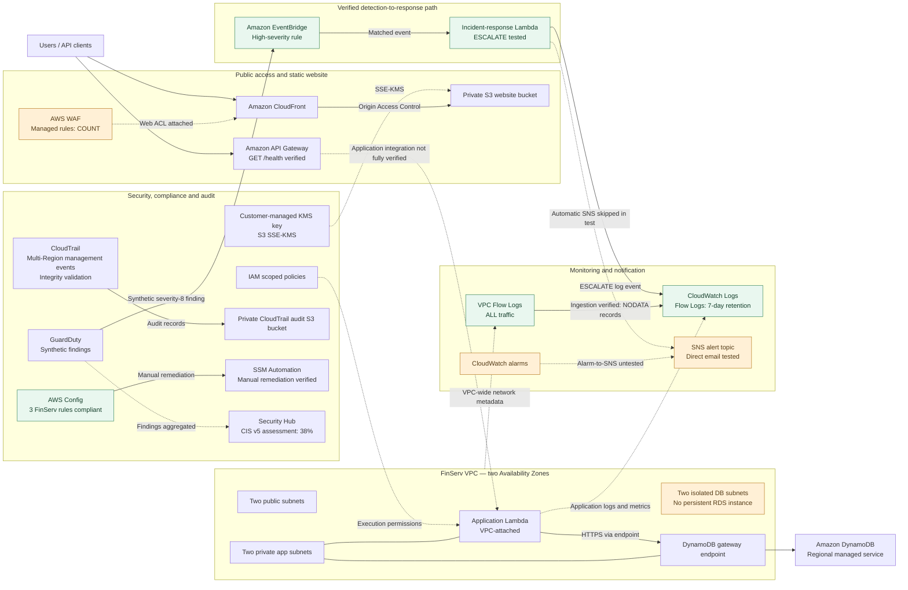

# FinServ AWS Security Architecture — Verified Lab Design

The diagram distinguishes deployed components, tested integrations, and features whose end-to-end operation remains unverified. It is a logical view; placement does not imply every component is inside the VPC.

**Evidence boundaries:** The GuardDuty finding was synthetically generated. Lambda logged `ESCALATE`, but its automatic SNS notification was skipped. CloudWatch received VPC Flow Log `NODATA` records; specific accepted/rejected traffic records were not demonstrated. RDS test resources were removed after testing. CIS 38% was the observed account score on November 22, 2026, not a certification or Manara project grade.

**Application caveat:** API Gateway `GET /health` was verified; this diagram does not imply that the CloudFront website successfully called a transaction API or that the entire application flow was end-to-end tested.
